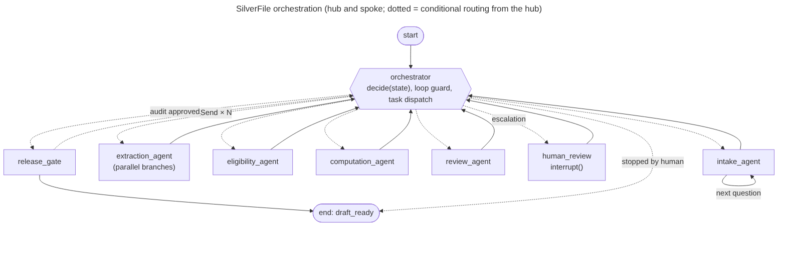

# SilverFile

> **To run and evaluate this project, follow [HOW_TO_RUN.md](HOW_TO_RUN.md).** One command with Docker: `docker compose up --build`, then open http://localhost:8000.
>
> **Demo video:** [`demo/demo_video.mp4`](demo/demo_video.mp4) (9 min 40 s). **Evaluation cases:** [`demo/eval_case_1.md`](demo/eval_case_1.md) (clean run) and [`demo/eval_case_2.md`](demo/eval_case_2.md) (human-in-the-loop event and how to resolve it).

A LangGraph multi-agent system that helps prepare a **draft** Form 1040-SR (tax year 2025) for seniors, built for Kushim as a proof of concept. It collects information, reads the W-2 (from its image with an Anthropic API key, or from the image's saved answer key in offline mode), computes the derived lines, and hands a human a draft return plus an audit record showing where every dollar figure came from.

SilverFile **never files** a return, **never gives tax advice**, and **never states a dollar amount it cannot source**. Anything out of scope, any advice request, and any sign of financial exploitation goes to a human.

## Status

| Part | State |
|---|---|
| Shared state schema (`src/state.py`) | Done |
| Provenance records (`src/tools/provenance.py`) | Done |
| Tax calculation tools (`src/tools/tax_math.py`) | Done, tested against IRS tables and worked examples |
| Computation agent (`src/agents/computation.py`) | Done |
| Intake agent and agent memory (`src/agents/intake.py`, `src/memory.py`) | Done, see `docs/INTAKE_INTERFACE.md` |
| Orchestrator and graph (`src/agents/orchestrator.py`, `src/graph.py`, `run.py`) | Done, see `docs/ORCHESTRATION.md` |
| Extraction, Eligibility, Review | Merged; wired into the graph |
| Review console (`dashboard/`) with the filled 1040-SR PDF | Done, see `dashboard/README.md` |
| Docker container (`Dockerfile`, `docker-compose.yml`) | Done, see `HOW_TO_RUN.md` |
| Evaluation cases (`demo/`, `evals/cases.json`) | Done, see `demo/eval_case_1.md` and `demo/eval_case_2.md` |

## Setup

```
git clone https://github.com/kapilgoyal11/SilverFile.git
cd SilverFile
```

You need **Python 3.11 or newer** (we tested on 3.13). The commands differ slightly by operating system:

| Step | Mac or Linux | Windows (PowerShell or Command Prompt) |
|---|---|---|
| Check the Python version | `python3 --version` | `py --version` |
| Create a virtual environment | `python3 -m venv .venv` | `py -m venv .venv` |
| Turn it on | `source .venv/bin/activate` | `.venv\Scripts\activate` |

If the version is older than 3.11 (a Mac's built-in `python3` is 3.9), install a newer Python from [python.org](https://www.python.org/downloads/) (on a Mac, `brew install python@3.13` also works). Then create the environment with that version: `python3.13 -m venv .venv` on Mac or Linux, or `py -3.13 -m venv .venv` on Windows.

Once the environment is on, `python` means the right version on every system, so the remaining commands are the same everywhere:

```
python -m pip install -r requirements.txt -r dashboard/requirements.txt httpx
```

The second requirements file and `httpx` are for the review console and its tests. An API key is optional: without one everything runs offline. To have Claude read W-2 images, copy `.env.example` to `.env` and set `ANTHROPIC_API_KEY`. Never commit `.env`.

## Run the tests

```
python -m pytest -q
```

All 489 tests should pass. Without the review console's packages, its 13 tests are skipped and 476 run (this is what GitHub Actions does).

## Try the Intake agent on its own

```
python run_intake.py --session test          # chat in the terminal; type quit to stop
python run_intake.py --session test          # run again later: resumes where you left off
python run_intake.py --session test --show   # print what intake collected
python -m scripts.measure_context --both     # regenerate docs/metrics.md
```

## Repository layout

```
src/state.py          shared state every agent reads and writes
src/graph.py          LangGraph wiring (orchestration)
src/agents/           one file per agent
src/tools/            deterministic tools: tax_math.py, tax_constants.py, provenance.py
data/                 fixtures and reference policy
evals/  tests/        evaluation cases and pytest suites
traces/  docs/  demo/ run traces, notes and metrics, demo material
dashboard/            review console and the filled 1040-SR PDF
Dockerfile  docker-compose.yml  HOW_TO_RUN.md   container and run guide
```

## Team and ownership

| Agent or area | Specialization | Owner |
|---|---|---|
| Orchestrator | Task division and management | David Reeves |
| Intake | Agent memory | Karan Shah |
| Document Extraction | Inter-agent communication | Rodrigo Gallegos |
| Eligibility & Rules | Guardrails and ethics | Narain Karthik |
| Computation | MLOps/DevOps | Kapil Goyal |
| Review / Audit | Security | Abdullah Almamoon |
| Review console, Docker, run guide | HITL dashboard, deployment and documentation | Nishitha Bodipati |

## Shared contracts

- **Amounts are whole-dollar integers.** Fixture W-2s must use whole dollars.
- **Filing status strings** are exactly `single`, `mfj`, `mfs`, `hoh`, `qss`.
- **Every dollar amount carries a provenance record** with kind `document`, `computed` or `user_input`. Computed records hold a formula and the inputs it used.
- **What Computation reads and writes** is documented at the top of `src/agents/computation.py`. If it cannot source a number, it returns an escalation and no numbers.
- **SSNs**: only fake 900-series numbers are accepted. Intake, Eligibility & Rules, Document Extraction and Review & Audit each enforce this.

## Tax sources and known assumptions

All 2025 constants are in `src/tools/tax_constants.py` with their sources: IRS Publication 915 (taxable Social Security), IRS Publication 1040 (Tax Table and Tax Computation Worksheet), and the assignment brief (standard and senior deductions).

Assumptions still to be confirmed with the instructor:

1. Line 16 follows the IRS method: Tax Table under $100,000, Tax Computation Worksheet from $100,000. The brief says "rate schedule".
2. A return with qualified dividends (line 3a above zero) is escalated, because the IRS uses a worksheet we have not built.
3. Rounding: only the final amount of the Social Security worksheet is rounded; the senior deduction rounds line 34 of Schedule 1-A (the phase-out amount) to a whole dollar.
4. The Social Security worksheet needs the Schedule 1 adjustments broken down by line, not just the line 26 total.
5. The structure of Form 1040-SR lines 17 to 23 comes from the 2024 layout and needs checking against the 2025 PDF.

## Orchestration

Hub and spoke. Every agent returns to the orchestrator, which reads the shared state and picks the next hop from a decision table (no LLM call). Extraction fans out as one `Send` per document and the hub is the fan-in. Review's send-backs are dispatched to the agent that owns the finding, once per round, and a human is pulled in through one `interrupt()` node for every escalation. Full design, decision table and loop guards: `docs/ORCHESTRATION.md`.



## Running the full system

```
python run.py --session demo-1 --state data/fixtures/eligibility/clean_single.json --ssn 900-12-3456
python run.py --session demo-2 --state data/fixtures/eligibility/hitl_advice.json --ssn 900-12-3456 --spouse-ssn 900-98-7654
python run.py --session demo-3 --state data/fixtures/eligibility/clean_single.json --ssn 900-12-3456 \
    --doc data/fixtures/w2_1.png --doc data/fixtures/int_1.json --offline
python run.py --session demo-4                       # full intake conversation from scratch
python run.py --session demo-2 --resume              # continue a paused session
```

`--state` seeds a finished intake so the run starts at Eligibility. When the graph pauses it prints why and waits: intake questions take a plain answer, human review takes `proceed <note>` or `stop <note>`. Sessions are checkpointed in SQLite (`silverfile_sessions.sqlite` or `$SILVERFILE_DB`) and resume by `--session` id. The final state is written to `traces/<session>_state.json`. To review sessions in the browser, resolve human-review items and download the filled 1040-SR, start the review console with `python -m dashboard` (see `HOW_TO_RUN.md`).